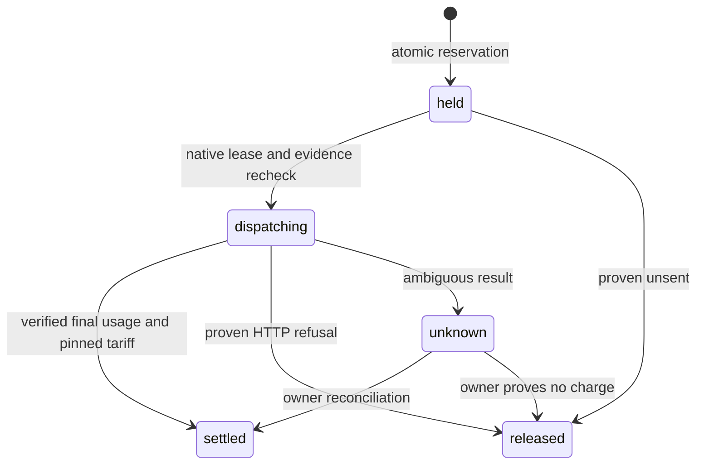

# ADR 0209 — Subscription-first API grant continuity

Date: 2026-11-20

Status: Implemented for review, disabled by default. Production migration, activation, merge and deployment require
the installation's existing release approvals.

## Context and scope

ADR 0208's Model Inspector already monitors subscription allowances, qualifies native routes and coordinates with
the existing executor, JEV, scheduler and task records. A subscription's API grant is a separate billing resource.
It cannot be inferred from the subscription name, an available API key, an API response, a soft budget alert or a
successful coding CLI session.

This extension uses the existing Model Gateway, executor, outbox, run transcript, tool receipts, approval authority,
audit log, notification inbox and Usage settings. It introduces no polling agent, alternate orchestrator, alternate
task database or native-session converter. Scheduled work enters the same executor through the existing jobs.

The supported grant routes are:

| Product | Allowed transport | Excluded interpretation |
| --- | --- | --- |
| OpenAI Pro API grant | First-party OpenAI Responses API, linked API organization | Codex API-key billing is not a grant-eligible route |
| Claude Ultra API grant | First-party Claude Platform Messages API | Interactive Claude Code is not an API-grant route |

The schema can name `claude_agent_sdk` for an eventual verified adapter. This implementation deliberately refuses
that route until a separate bounded adapter is implemented and tested. The supported Claude Platform API route
already supplies Claude grant fallback; the native interactive harness is never relabeled as an SDK request.

## Evidence and authority

An active organization owner registers an explicit provider account, product, actual grant ID, billing cycle,
activation time, seven-day eligibility evidence, grant start/expiry, issued amount, observed remaining amount,
verification time, evidence reference and validity deadline. Each reference must point to independently reviewed
official billing evidence. Registration records the owner's assertion; it does not fabricate evidence or prove an
account's balance by calling a model.

There is no assumed public grant-balance endpoint. Usage/cost reports measure consumption and can lag. Neither a
usage report nor a successful request proves a subscription grant is active. The implementation does not scrape a
provider's private dashboard, activate a grant, purchase credits, enable automatic reload or change billing settings.

Eligibility and remaining-balance evidence expire within at most 24 hours and never beyond the grant's expiry.
Admission and dispatch require at least the full two-minute request deadline remaining. Handoff proofs themselves
last no more than five minutes and are requalified for every API call.

Grant-only enforcement must be independently verified. All other use of the same upstream account must either be
excluded or have a verified upper bound covering the entire evidence lifetime, unreported/in-flight consumption
and reporting delay. A historical usage estimate or a provider's soft project-budget alert is not that bound.
Unknown eligibility, funding enforcement, remaining balance or external exposure means zero automatic authority.

Each exact model also requires separate owner-reviewed pricing evidence: official reference, verification/expiry
times and an immutable profile hash covering provider, first-party endpoint, standard service tier, context/output
limits, token categories and long-context/cache pricing. Missing, expired, altered, unpriced or ambiguous pricing
fails closed. Introductory pricing schedules are unsupported until they have a pinned effective-time policy.

Only owners may register/enable routes, approve reserve use or reconcile attempts. An administrator is not an owner.
The authenticated actor is derived from the session, checked against current active membership and audited.

## Budget allocation

All monetary values are nonnegative safe integers in nano-USD (`1 USD = 1,000,000,000 nano-USD`). For actual issued
grant `G`, the protected allocation is:

```text
safety    = min(20 USD, G)
emergency = min(60 USD, max(0, G - safety))
automatic = min(120 USD, max(0, G - safety - emergency))
```

| Actual grant | Automatic limit | Emergency limit | Unspendable safety |
| ---: | ---: | ---: | ---: |
| $200 or more | $120 | $60 | $20 |
| $150 | $70 | $60 | $20 |
| $100 | $20 | $60 | $20 |
| $80 | $0 | $60 | $20 |
| $50 | $0 | $30 | $20 |
| $10 | $0 | $0 | $10 |

Unused grant above $200 does not increase these caps. Provider pools do not borrow from each other. The emergency
bucket requires a current owner's explicit, expiring, cycle-scoped approval with its own amount and idempotent
decision key. It cannot enlarge the emergency limit or spend the safety buffer. A call uses one bucket; it is not
split to bypass an approval.

The actual remaining balance is an additional limit. Local settled charges since a balance observation are deducted
once, together with outstanding reservations, the external-spend bound and protected buckets. Evidence refresh
cannot erase spend, free unresolved holds, increase the cycle's allocation or revive funds from a lagging balance.
A later cycle is a new retained row. Unresolved prior-cycle liabilities prevent rollover.

## Transactional ledger and pricing

Migration 0283 adds `credit_pools`, `credit_grant_cycles`, `credit_routes`, `credit_reserve_approvals`,
`credit_work_units` and `credit_attempts`. A nullable fingerprint on existing credentials supports identity binding
without replacing their IDs or encrypted secrets. Existing migrations are unchanged.

There is at most one pool for an organization/provider, and an upstream provider/account cannot be duplicated across
organizations. Pool/cycle locks serialize reservations from all agents and server replicas. The work-unit key is the
existing run ID plus its next native turn number. Attempt identity includes the existing outbox job and claim epoch.

Admission validates the native outbox job, worker, attempts counter, lease, organization and run. It reserves the
entire catalog context window as potential input plus the bounded requested output at the highest applicable rate.
This intentionally conservative ceiling includes client tool schemas, input/cache categories and reasoning output.
A character/token heuristic or a statistical forecast never authorizes spending.

The gateway normalizes only internal system-block metadata to the actual adapter payload. Unsupported modalities,
unbounded native tools and arbitrary opaque/session payloads are refused. Same-provider signed/encrypted reasoning
receipts required for a subsequent API tool turn are narrowly validated and preserved unchanged. They do not cross
from a native harness into the API handoff.

The exact reviewed tariff and cache policy are saved on the attempt. Actual verified token categories are reconciled
against this saved snapshot, including Claude's distinct five-minute and one-hour cache writes. Later catalog edits
cannot reprice an in-flight request. Pricing evidence/hash, capability requirements, credential identity/version,
grant evidence, approval and protected balance are checked again immediately before dispatch.



A repeated reservation or dispatch never grants permission for a second transport call. The losing caller cannot
release, settle or poison the winning caller's attempt. Abandoned `dispatching` and `unknown` holds have no TTL-based
release. A cost overrun is recorded in full, rather than clamped to the reservation, and trips the pool breaker.
Contradictory repeated receipts also trip a breaker. Owner reconciliation is audited and does not complete a task.

## Provider transport

Grant calls explicitly pin first-party API base URLs. Environment base-URL overrides, compatible adapters and
credential-specific endpoints cannot redirect them. OpenAI requests select `service_tier: default`; Claude requests
select `service_tier: standard_only` and standard speed. Final receipts must affirm the expected pricing tier.

Grant calls disable SDK retries, extra thinking-repair requests, server-side model fallback and speculative cache
prewarming. The request has a two-minute abort deadline. The final model must match the reserved exact model ID;
an alias resolving to another snapshot is refused until explicitly qualified.

Verified final usage requires the provider's terminal response events, valid token counters and complete cache/tier
metadata. Missing, inconsistent, partial or different-model receipts retain an unknown debit. A stop or timeout does
not prove zero cost. Real request/response identifiers are retained separately where supplied; none are invented.

Temporary rate limiting is distinguished from credit exhaustion and account/project spending enforcement. Explicit
HTTP refusals can release this attempt; an error after an accepted stream cannot. Billing/credential failures end
the route, while accepted/ambiguous failures pause it for reconciliation.

## Credential protection and preparation impact

Every grant call uses the existing encrypted credential and its exact version. A retained route fingerprint protects
the original upstream secret after local rotation or revocation. Re-entering it under another credential ID,
organization or custom endpoint cannot evade the ledger. Fingerprints and secrets are never returned in reports.
Legacy credentials can acquire this internal identity through an owner-authorized backend verification of the
existing encrypted key, with a ciphertext compare-and-set. Their IDs, keys, owners and repositories are preserved.

**Registering a provider pool has an immediate safety effect even while fallback is disabled:** ordinary calls to
that provider in the organization are refused because another credential ID does not prove an independent billing
account. This includes defaults, summaries, router calls, platform fallbacks and key probes. Embeddings retain their
existing full-text fallback. A different organization with an unrelated secret retains its ordinary API behavior.

This conservative boundary prevents an unproven ordinary billing route from silently spending the same grant.
Preparing a live pool is therefore a deliberate owner action with a workload-availability impact; it is not a no-op
configuration draft. No pools are registered automatically by the migration or feature flag.

Credential selection retains the existing cache, but the ordinary-call protection verdict uses one fresh SQL
statement per call. Provider-account protection, reserved credential identity and retained cross-workspace secret
fingerprints are checked together. A newly registered pool therefore blocks the next call even if its default
credential lookup was already cached. The availability probe separately combines provider and credential checks
in one fresh statement without decrypting secrets. Availability is not spending authority. A warm ordinary run
therefore adds exactly two statements, independently measured against the deployed baseline.

A registered pool also holds the workspace's final deletion, including after grant expiry or local key revocation.
The organization, allowance history, unresolved debits, reserve approvals and retained fingerprints stay intact.
Without independent upstream revocation and a separate accounting-retention procedure, deletion must not erase a
spend guard or permit the same upstream account to obtain a fresh allowance. The purge returns a retained result
before account cleanup and repeats the hold under its final row lock. Pool registration takes the existing
workspace membership lock and row lock, and refuses a workspace already closing, so registration and deletion
cannot race across that initial check. This release does not automate removal of that financial retention hold.

## Subscription-first handoff and native recovery

The executor first considers its existing compatible subscription candidates. Only a fresh, account-wide exhausted
subscription can authorize API fallback. The source must prove subscription sign-in, no paid extra usage, valid
account ownership and fresh probe/turn telemetry. Model-specific limits, generic throttles, stale observations and
already-reset windows do not authorize API spending.

Before selecting an API route, the executor derives a minimum model tier from the resolved source model's explicit
catalog tier and the strongest existing durable task choice (`autoModel` or Model Inspector's handoff selection).
Tool work requires at least the medium tier. A fixed source model supplies a conservative no-downgrade floor when
there is no existing task judgment. Both the source and candidate must have an explicit known catalog tier; price,
route ID and provider name do not establish quality. The ordinary nearest-tier mapper is not used because it can
choose a smaller model. Unranked source or candidate models remain ineligible until separately qualified.

The selected minimum tier, supported reasoning effort and capability set are retained on the native credit
checkpoint, carried through the gateway and saved in each reservation. Codex `xhigh` and `max` normalize to `high`
under the same existing Codex runner contract. Claude Code preserves those distinct native settings, so an explicit
Claude `xhigh` or `max` refuses automatic API fallback until an equivalent API capability is qualified. The current
API adapter's `high` setting is not assumed equivalent. No extra JEV call is made to choose a credit route. Restart
cannot replace the retained requirement with a weaker default. Admission and dispatch compare the requirement
with the durable run under the existing row lock, recheck the candidate's current catalog qualification and require
the same requirement for an idempotent attempt. A changed requirement or unknown quality prevents transport. The ledger's rejection itself
does not release or replay an existing reservation; the gateway may still close a proven-unsent attempt through
its existing no-charge path. Accepted or ambiguous obligations remain retained for reconciliation.

API admission happens at an existing safe turn boundary. The transaction rechecks the source session actually
allocated by the resolver, agent configuration/ownership, current native lease, pending approvals, uncertainty
markers and unmatched native tool receipts. It retains the original agent, run, task, channel and goal. Only portable
text and known action receipts enter the API context. No native session is imported. Returning to a subscription
allocates a fresh session carrying the portable record.

Personal right-hand and mission harness routes retain their existing explicit contracts until a separately verified
portable capability path supports them. Ineligible work keeps its native wait/checkpoint; it is not silently moved
to a weaker API workflow. Existing Model Inspector/JEV suitability, tools, authorization and completion evidence
remain authoritative.

Before API dispatch, the native transcript persists a per-turn in-flight marker. After receipt, the response,
native turn counter and model-call step are committed before a tool runs. The marker remains through native final
verification/JEV. It clears only with a durable tool-result/approval/continuation checkpoint or the justified final
native transition. Every credit-run transcript write, tool boundary and state transition is fenced by the existing
outbox claim. A stale writer cannot erase a successor's sticky credit hold or post an unverified final result.

The existing restart path reconstructs obligations from PostgreSQL. A proven unsent/no-charge attempt may continue;
an unresolved attempt or missing response checkpoint parks the same run in `waiting_input`. New chat messages do
not answer that accounting hold. Cost reconciliation alone does not prove a billed response or external action was
completed. A lost accepted response remains held until native state can be reconciled; it is never automatically
replayed to improve apparent success rates.

An owner's explicit resume action requires resolved billing obligations and no pending/unknown native effects.
It enqueues the same `agent_run.execute` through the existing outbox exactly once. It creates no agent, task or
alternate job system. Task acceptance is never inferred from an API success, cost receipt or forecast.

## Forecasts, reporting and notifications

Model Inspector's existing report and authenticated read endpoint expose current grant, expiry, pricing evidence,
limits, actual spend, reservations, protected reserve/safety and unresolved attempts. Reads use the durable ledger
even when admission is disabled. Missing tables/data are reported as unavailable/unverified, not as a verified zero
balance. Existing permission checks remain `manage_agents` plus `view_usage`.

Forecasts use recent distinct settled work units and show mean/p95 cost, sample count and uncertainty. No samples
means unknown. The p95 estimate is descriptive; the finite next-unit ceiling remains the admission rule. The existing
Usage page displays both providers and links the native notification inbox to the same view. One durable incident
group per provider pool/cycle prevents a fleet outage from creating one alert per agent. Task-level handoff notices
retain the native conversation context.

## Owner API

All mutations use the existing authenticated/CSRF-protected app API under
`/api/app/organizations/{orgId}/credit-continuity`. Bodies are strict; server-selected IDs, actor identity, encrypted
keys and enabled-state defaults cannot be supplied by the caller.

| Method | Suffix | Authority and effect |
| --- | --- | --- |
| POST | `/pools` | Owner evidence; disabled pool with protected billing boundary |
| PATCH | `/pools/{poolId}/evidence` | Conservative same-cycle evidence refresh |
| POST | `/pools/{poolId}/cycles` | Verified later cycle; new admissions disabled |
| POST | `/routes` | Existing credential, exact supported model and reviewed pricing; disabled |
| PATCH | `/routes/{routeId}/pricing-evidence` | Review new pricing evidence; route disabled pending enable |
| PATCH | `/routes/{routeId}` | Owner enable requires feature flag; disable remains available |
| POST | `/pools/{poolId}/emergency-approvals` | Feature flag plus explicit bounded owner approval |
| POST | `/attempts/{attemptId}/reconcile` | Explicit settled/released outcome with evidence, audited |
| POST | `/runs/{runId}/resume` | Native checkpoint/effect reconciliation and same-run enqueue |

Disabling, observing and reconciling remain available when new admissions are off. There is no purchase, payment,
automatic top-up or spend-limit-increase endpoint.

## Verification and release gate

Tests use synthetic providers and isolated databases. Coverage includes separate PostgreSQL clients racing against
one budget, a separately launched worker recovering a retained unknown debit, exactly-one transport dispatch,
credential aliases and rotation/revocation, lease loss, effect receipts, stale evidence, expiration, approvals,
tariff changes, partial/missing/tier-invalid usage, two-turn tool calls, status authorization and notification grouping.
The release evidence must record exact source revision, migration, test commands/results and remaining limitations.

Before activation, the release owner must review the actual upstream grant and billing enforcement, linked account,
external-spend boundary, exact model/pricing evidence and supported capability scope. Apply additive migration 0283
through the existing release process and deploy all gateway/executor workers with the flag still off. Verify durable
status and recovery before enabling a reviewed route. A code test is not live grant evidence.

Rollback first disables admission and routes. Keep ledger tables, holds, fingerprints and reports. Do not revert to
an old gateway that lacks grant-key protection while registered grant keys remain usable. Revoking a local key is
not proof of upstream revocation, and deleting accounting rows is never a rollback step.

## Provider references

- [OpenAI: API credits for ChatGPT subscribers](https://developers.openai.com/api/docs/guides/chatgpt-api-credits)
- [OpenAI: API error codes](https://developers.openai.com/api/docs/guides/error-codes)
- [Claude: API credits for subscribers](https://platform.claude.com/docs/en/about-claude/api-credits-for-subscribers)
- [Claude: API rate limits and spending enforcement](https://platform.claude.com/docs/en/api/rate-limits)

These references explain provider eligibility and supported transports. They are not evidence that any particular
installation has activated a grant, has a remaining balance or has disabled paid funding.
